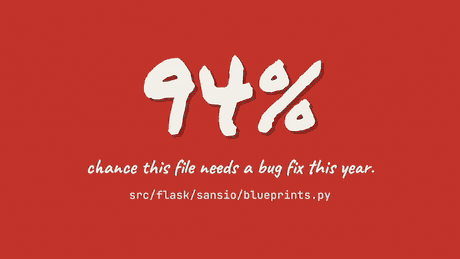
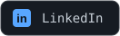

  

<h3><code>atharva@github ~ $ whoami</code></h3>

<table>
  <tr>
    <td valign="top"></td>
    <td valign="top"></td>
  </tr>
</table>

 

<h3><code>atharva@github ~ $ cat featured/evomind.md</code></h3>

<table>
  <tr>
    <td valign="middle" width="400">
      <h3>EvoMind</h3>
      <b>Know which files will break next, before they do.</b>
        
      EvoMind reads a Git repository's commit history, learns which files went on to need bug fixes, and ranks today's files by the chance that they will need one next.
        
      Risk ranking · Reasons per file · Risk trend · Architecture map · Pull-request check
        
      <a href="https://evomindai.vercel.app"><b>Live demo</b></a> · <a href="https://github.com/AtharvaDeshmukh1011/evomind"><b>Source</b></a>
    </td>
    <td valign="middle"></td>
  </tr>
</table>

 

<h3><code>atharva@github ~ $ ls projects/</code></h3>

<a href="https://github.com/AtharvaDeshmukh1011/live-cricket-score"><b>LiveCricket</b></a> real-time cricket scoring with Spring Boot, React and server-sent events
 
<a href="https://github.com/AtharvaDeshmukh1011/MILKMAN"><b>Doodhwala</b></a> milk delivery and billing app with React, Express and MySQL
 
<a href="https://github.com/AtharvaDeshmukh1011/uml-class-diagram-generator"><b>UML Class Diagram Generator</b></a> draw a class diagram, get the Java code

  

<h3><code>atharva@github ~ $ ./contact.sh</code></h3>

&nbsp;

